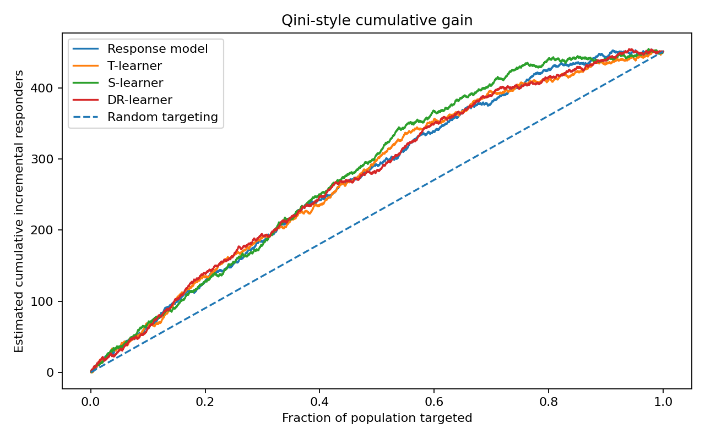
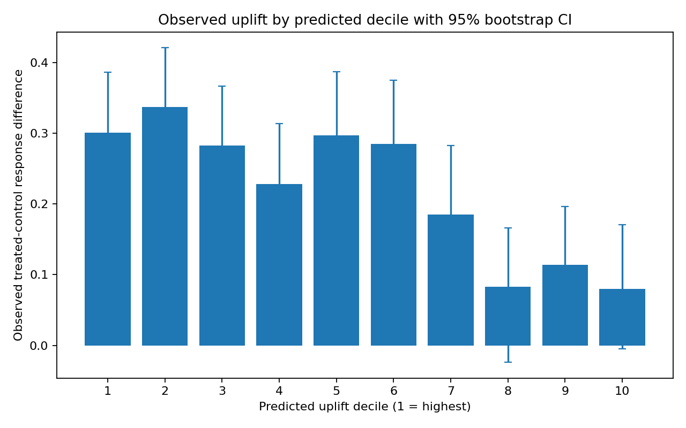
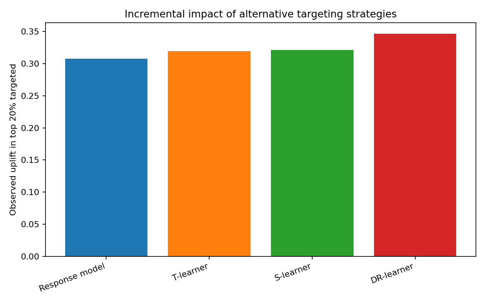

# Uplift Modeling for HCP Educational Outreach

A technical demonstration of **uplift modeling and heterogeneous treatment effect estimation** in a pharmaceutical commercial setting using fully synthetic data.

## Business Question

A commercial analytics team has limited capacity for an HCP educational outreach program.

A conventional response model asks:

> Who is most likely to engage?

An uplift model asks:

> Who is more likely to engage **because of the intervention**?

The goal is to estimate the conditional average treatment effect (CATE):

\[
\tau(x) = E[Y(1)-Y(0)\mid X=x]
\]

where:

- \(Y(1)\) is the potential outcome under treatment,
- \(Y(0)\) is the potential outcome without treatment,
- \(X\) is the observed feature vector.

This distinction matters because a high-response HCP may have engaged even without outreach. Uplift modeling focuses instead on **incremental impact**.

## Why Uplift Modeling?

Traditional response modeling estimates:

\[
P(Y=1 \mid X)
\]

Uplift modeling estimates:

\[
P(Y=1 \mid T=1,X)-P(Y=1 \mid T=0,X)
\]

This enables targeting based on expected incremental response rather than baseline propensity.

Conceptually, individuals may fall into groups such as:

- **Persuadables** — more likely to respond because of the intervention
- **Sure things** — likely to respond with or without intervention
- **Lost causes** — unlikely to respond under either condition
- **Negative responders** — intervention may reduce the desired outcome

## Dataset

The repository uses a **fully synthetic randomized experiment**. No patient, HCP, proprietary, or company data are used.

Synthetic HCP-level variables include:

- baseline engagement
- patient volume
- digital engagement
- prior educational interactions
- formulary access
- specialty indicators

Treatment represents an educational outreach intervention and is randomized 50/50.

The simulation introduces heterogeneous treatment effects on the **log-odds scale**, then converts them to the probability scale:

\[
\tau_{\text{true}}(x)=P(Y=1\mid T=1,X=x)-P(Y=1\mid T=0,X=x)
\]

This makes it possible to compare estimated uplift with the known simulated individual treatment effect.

## Methods

The project compares four approaches.

### 1. Conventional Response Model

A standard classifier predicts outcome probability from \(X\) while ignoring treatment assignment.

This is useful as a baseline because it illustrates a common targeting mistake: ranking individuals by **likelihood of response** rather than by **incremental effect of treatment**.

### 2. T-Learner

Separate outcome models are fitted for treated and control observations:

\[
\hat{\tau}(x)=\hat{\mu}_1(x)-\hat{\mu}_0(x)
\]

### 3. S-Learner

A single outcome model is fitted with treatment as an additional feature:

\[
\hat{\tau}(x)=\hat{\mu}(x,T=1)-\hat{\mu}(x,T=0)
\]

### 4. Doubly Robust Learner

A doubly robust pseudo-outcome combines outcome regression with the treatment propensity:

\[
\psi_i =
\hat{\mu}_1(X_i)-\hat{\mu}_0(X_i)
+
\frac{T_i(Y_i-\hat{\mu}_1(X_i))}{\hat e(X_i)}
-
\frac{(1-T_i)(Y_i-\hat{\mu}_0(X_i))}{1-\hat e(X_i)}
\]

A regression model is then fitted to \(\psi_i\) to estimate heterogeneous treatment effects.

Because treatment is randomized here, the true propensity is approximately 0.5. In observational applications, propensity estimation and overlap diagnostics become essential.

## Evaluation

Uplift models require treatment-aware evaluation. A classifier can have good predictive accuracy while still ranking incremental treatment effect poorly.

This project reports:

- uplift by predicted decile
- bootstrap 95% confidence intervals for observed uplift by decile
- cumulative incremental gain
- Qini-style cumulative gain curves
- Qini-style area above random targeting
- correlation with the known true treatment effect
- comparison against conventional response-model targeting

> **Note:** the reported Qini-style area is intentionally described as an area-above-random metric rather than a universal normalized Qini coefficient. Its magnitude depends on sample size and the gain scale.

## Results

The uplift models concentrate incremental response in the highest-ranked population segments more effectively than conventional response targeting.

The strongest models produce:

- positive Qini-style gain area above random targeting
- materially higher uplift in top-ranked segments
- substantial correlation with the known simulated treatment effect
- better cumulative incremental gain than ranking by predicted response probability

Observed uplift by decile is **not expected to be perfectly monotonic**. Each decile contains a finite randomized sample, so treated-control differences are noisy. Cumulative gain is generally the more stable ranking diagnostic.







## Running the Project

Install dependencies:

```bash
pip install -r requirements.txt
```

Run the analysis:

```bash
python src/uplift_modeling.py
```

The script generates:

```text
data/synthetic_hcp_outreach.csv
data/uplift_deciles.csv
data/model_summary.csv
figures/qini_curve.png
figures/uplift_by_decile.png
figures/targeting_comparison.png
```

## Repository Structure

```text
.
├── README.md
├── LICENSE
├── .gitignore
├── requirements.txt
├── src/
│   └── uplift_modeling.py
├── notebooks/
│   └── uplift_modeling_walkthrough.ipynb
├── data/
│   ├── synthetic_hcp_outreach.csv
│   ├── uplift_deciles.csv
│   └── model_summary.csv
└── figures/
    ├── qini_curve.png
    ├── uplift_by_decile.png
    └── targeting_comparison.png
```

## Production Considerations

This repository focuses on modeling and evaluation rather than production deployment.

A production implementation would additionally require:

- validated and reproducible data pipelines
- automated tests and CI/CD
- model and experiment versioning
- model monitoring and drift detection
- governance and auditability
- integration with approved enterprise data and AI platforms
- privacy and regulatory review
- appropriate human oversight
- prospective validation of any targeting policy before operational use

## Key Takeaway

A conventional response model identifies individuals who are likely to respond.

An uplift model identifies individuals whose outcomes are most likely to **change because of the intervention**.

For intervention targeting and constrained resource allocation, that distinction can materially improve decision quality.

## Disclaimer

This project is for educational and technical demonstration purposes. All data are synthetic and do not represent real patients, healthcare professionals, products, or commercial activities.
